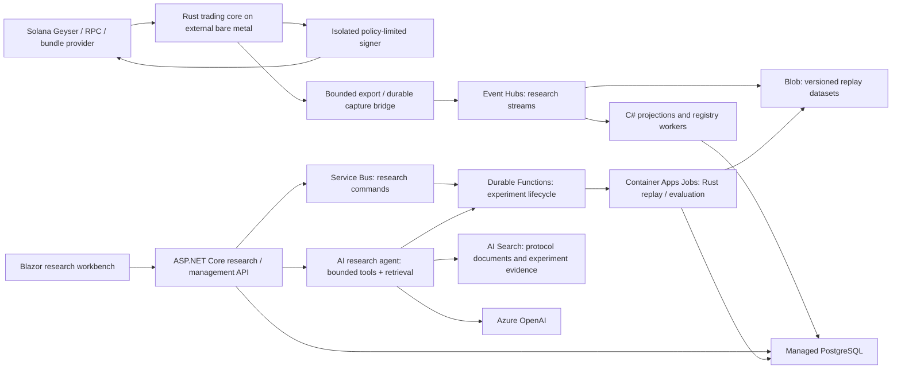

# MEVANA Azure AI Rearchitecture Assessment and Development Plan — updated 2026-10-07 00:18 CT

**Purpose:** Evaluate the existing MEVANA source and identify practical paths to a Rust/C#/Azure PaaS platform that develops advanced AI engineering and architecture skills.

**Repository reviewed:** `/Users/michaelinman/Repos/mevana`  
**Source baseline:** `main`, commit `ee27b3981cb9bb91a25da8ad7f4f0a11fdb3f96d`; clean working tree at inspection start.  
**Technology reference:** `/Users/michaelinman/Repos/AzureLeadInterviewLab/Order.Api/Docs/Azure_Lead_Interview_Cliff_Notes.md`.  
**Original assessment:** October 6, 2026, America/Chicago.

**Plan revision:** October 7, 2026, 00:18 CT; incorporates subsequent design discussion. Source findings remain tied to the original baseline; no new runtime verification is implied.

**Status:** Source investigation and proposed architecture. No application rewrite, deployment, wallet operation, credential change, or live trade performed.

## 1. Recommendation

MEVANA is a good candidate for a substantial rearchitecture, but a blanket Rust-to-C# translation would deliver less value than separating its responsibilities.

Build **an AI-guided Solana DEX arbitrage platform**, retaining the Rust trading core on a separate dedicated bare-metal server outside Azure. Build research, experiment management, pair-and-route ranking, integration, and reporting in C# and Azure PaaS. Preserve protocol implementations while repairing inconsistent execution outcomes, persistence, and replay.

The initial AI target is ranking **token pair + DEX/pools + direction + trade size** by likely executable opportunity value after costs. It should concentrate attention on promising routes and detect liquidity, spread, and market-regime patterns. Rust independently checks current state, executable quotes, expiry, balances, costs, and risk limits. Azure never authorizes an individual trade through a latency-sensitive round trip.

The scope is **Solana decentralized exchanges**. Centralized exchanges, cross-chain transfers, and directional/statistical pair trading are outside the initial scope. Initial DEXs, pools, and token universe remain to be selected from validated decoder/quote support; named venues in existing code are not proof of complete support.

The research workbench supports captured datasets, constrained experiments, Rust replay jobs, baseline comparisons, and cited explanations. An LLM assists research; predictive ML ranks markets/routes. Neither is a substitute for deterministic arbitrage arithmetic. The objective is to test whether an economic edge exists, not assume profitable trading.

**Development can begin immediately on the Azure/.NET side, before running Geyser or repairing the complete Rust core.** Agree on versioned contracts first, then develop Azure infrastructure and Rust correctness/replay as parallel workstreams. Credible strategy results and trained ranking models depend on trustworthy market captures and validated replay later.

This gives you meaningful demonstrations of ASP.NET Core, EF Core, Service Bus, Functions, Durable Functions, Redis, identity, API Management, observability, Blazor, containers, Bicep, CI/CD, and failure recovery. These services belong around the execution core; putting them between a fresh market update and a trade would add network and coordination costs without proving a benefit.

The current repository contains useful engineering assets, but its labels and documentation overstate some capabilities. Treat it as an existing system to validate and selectively reuse, rather than a certified profitable or production-ready baseline.

## 2. Investigation method and limits

Inspected the Cargo workspace, executable entry points, core streaming/detection/execution paths, representative protocol decoding and quoting, replay harness, shared event definitions, registry services, API routing/authentication, wallet boundaries, persistence paths, Compose definitions, CI workflows, tests, and architecture documents. Cargo metadata resolved **25 workspace members**. Representative source inventory contains roughly 73,000 Rust lines across the listed non-archived crate `src` directories; line count measures code volume, not implementation completeness. The hotpath crate contains about 19,800 lines and executor about 12,700.

The Azure notes were read for their syllabus and architectural constraints. Current Microsoft documentation was checked for important platform migration details.

This is a deep static architecture review of selected critical paths, not a line-by-line audit of every file. Archived code was not treated as active implementation. Secret-bearing local files, wallet backups, and private key material were excluded. No providers, database services, containers, deployments, or trading processes were started. Current hosting, real profitability, service health, Azure subscription permissions, quotas, and costs remain unverified.

Documentation comments such as “zero latency,” 10,000 TPS, and 99.9% uptime are claims or targets, not measurements established by this review. An existing September 2025 latency artifact contains network/RPC timing measurements, not an end-to-end detector-to-confirmed-trade benchmark.

## 3. What the source actually contains

### 3.1 Two overlapping trading architectures

**Direct streaming path:** `hotpath_arb_engine/src/main.rs` connects to Yellowstone/Geyser streams, invokes generated normalizers, derives opportunities, applies a smart filter, and queues execution. The crate imports arbitrage, normalizer, quoting, and executor libraries directly. This is substantially an integrated Rust application, even though many components also have standalone service entry points.

**Kafka edge path:** the normalizer consumes raw transactions and produces normalized swaps; the edge assembler builds pool state and protobuf edge updates; arbitrage code evaluates quotes/cycles; signals can reach the executor through Kafka or WebSocket adapters. The hotpath process also starts an `edge.delta.v1` Kafka consumer in its background tasks. Consequently, the “hotpath has no Kafka dependency” documentation describes an intended direct path, not every currently available detection mode.

**Supporting paths:** several services persist related data, expose overlapping history/metrics APIs, maintain token and DEX registries, collect prices, and manage wallets. The event bus itself writes files, Kafka, Redis, and PostgreSQL. Another asynchronous history writer and another Kafka DB writer also exist.

Do not preserve all of these service boundaries merely because they already exist. Multiple crates are reusable libraries or implementation variants, rather than independently justified microservices.

### 3.2 Component disposition

| Existing component | Observed responsibility | Proposed disposition |
|---|---|---|
| `hotpath_arb_engine` | Geyser connections, detection, filtering, execution coordination, APIs, settings, history, experimental AI | Retain Rust streaming/detection; extract research, configuration management, and reporting |
| `normalizer-runtime`, `normalizer-generated`, `normalizer-codegen`, `mevana-idl-registry` | Protocol extraction, IDL-driven decoder generation | Retain Rust and version decoder artifacts; add golden captures and compatibility tests |
| `edge-assembler` | Pool state and protobuf edge construction | Retain Rust initially; validate state correctness and ordering |
| `arb-engine`, `whirlpool-core` | Graph/quote evaluation, sizing, protocol math, replay | Retain Rust; establish numerical correctness and reproducible replay first |
| `executor-service`, flash-loan libraries | Transaction construction, simulation, bundle submission, confirmation, wallet integration | Retain Rust; unify supported execution path and isolate signing |
| `api-service` and gateway | REST history, wallet views, proxies, Kafka-to-WebSocket/SSE fanout | Strong ASP.NET Core replacement candidate; replace contracts deliberately |
| `monitoring-service`, `wallet-metrics-exporter` | Redis/DB metrics aggregation and wallet observations | Consolidate read models and telemetry; C# worker where appropriate |
| `token-registry-service`, `dex-registry` | Metadata, discovery, cache, versions, plugins | Strong C# candidate for registry management; keep protocol-sensitive code in Rust |
| `discovery-service` | Unknown-program observations, cache, AI-analysis queue | Extend into a real C# research workflow; current queueing is not completed AI analysis |
| `price-aggregator` | Kafka swap-derived rolling price feeds | C# candidate for research feeds; benchmark before using on a critical trading path |
| `kafka_db_writer`, hotpath history/event persistence | Historical writes across multiple paths | Replace with one canonical event archive and idempotent projections |
| `wallet-vault` and other wallet managers | Encryption, backup, key access, wallet operations | Preserve assets; independently review signer and custody boundaries before migrating |
| `resilience-framework`, `shared-core`, `shared-protocol` | Retry/circuit utilities, ports, DB helpers, Rust event DTOs | Selectively reuse; define language-neutral contracts rather than porting every helper |
| `mevana-engine` | Additional engine variant | Compare against selected baseline; do not make it a new deployable by default |

### 3.3 Valuable assets to preserve

- Yellowstone/Geyser integration and reconnect logic.
- Generated Solana instruction decoders and protocol-specific parsing knowledge.
- Pool/edge representations, staleness checks, and graph/cycle evaluation.
- Rust transaction construction, simulation, provider adapters, and account manifests.
- Config and registry hashing, audit structures, mTLS-related tests, and execution status types.
- Replay tooling and offline signal-generation tests.
- Existing encrypted wallets, backups, passwords, API keys, and local configuration, preserved unchanged during assessment and any initial additive migration.

Preservation means retaining behavior and evidence worth testing; it does not mean accepting every implementation as correct.

## 4. Findings that materially affect a rewrite

### F1. Experimental detections cannot establish real arbitrage

`hotpath_arb_engine/src/main.rs:3400` onward contains strategies that create opportunities using characters in a transaction signature, with fixed basis-point profit values and placeholder token names. These include concentrated-liquidity, DLMM, CLOB, and Jupiter-related scaffolding. The direct detector calls strategy helpers, and heuristic detection defaults to enabled when the setting is absent (`main.rs:2518`). Some malformed placeholder mints will be rejected later, but emitting such opportunities still pollutes analysis and metrics.

**Implication:** separate experimental fixtures from real-data detection. Require valid pool state, coherent mint/decimal units, fees, route state, and quote provenance before classifying a candidate as executable. This is a correctness prerequisite, not a language-porting task.

### F2. Execution implementations have inconsistent truth semantics

`LiveTradingEngine::execute_live_trade` simulates even its nominal live branch (`main.rs:1465`). This helper's existence does not establish that it is the selected production execution route. Separately, the integrated hotpath calls `ExecutionOrchestrator`, whose live flash-loan branch returns `true` with a TODO (`execution_orchestrator.rs:322`). The standalone `ExecutionEngine` has genuine simulation/submission logic and multiple live gates, but its preflight-only path increments a bundle-confirmation success metric (`execution_engine.rs:1431`).

The standalone engine's landed-bundle branch also populates `actual_profit_lamports` from simulated token deltas or falls back to estimated profit (`execution_engine.rs:1503`). A separate reconciliation field/task exists later, so the initial “actual” field and realized-profit counter are not sufficient economic evidence.

**Implication:** choose and validate one execution pipeline. Distinguish detected, quoted, simulated, preflight-passed, submitted, landed, confirmed, finalized, and reconciled. An ambiguous submission becomes unknown until reconciled; a retry must not create a duplicate economic action. Do not train against generic “success” counters or unreconciled profit fields.

### F3. Training feedback can record intent as an outcome

After queuing execution, the hotpath schedules `SMART_FILTER.record_result(..., true, estimated_net_profit)` (`main.rs:2667`). That records estimated success without waiting for the economic result. AI helper initialization also constructs fresh strategy engines/orchestrators per call (`main.rs:1766`), which can fragment learning state and add work.

**Implication:** join immutable decisions to actual execution outcomes and reconciliation. Estimated profit, simulated profit, and realized profit need separate fields and separate labels. Keep model lifecycle and learning outside transaction handling.

### F4. Persistence can discard failed work

The asynchronous history channel is unbounded (`async_history_buffer.rs:71`), and `flush_buffer` logs failed batches then clears its buffer (`:212`). `KafkaDbWriter::flush_buffers` drains buffers into a transaction and clears remaining events even after a failed write or commit (`kafka_db_writer/src/main.rs:199`). Auto-commit is disabled, but no explicit offset commit call was found in this writer, so restart replay/deduplication behavior also needs definition. The event bus independently writes four destinations and logs failures.

**Implication:** define one durable archive/projection boundary. Acknowledgment/checkpoint follows durable acceptance. Add bounded buffering, retry classification, poison-event handling, and stable deduplication keys. Off-thread work is not automatically durable or incapable of slowing the producer.

### F5. Event and schema drift will make a mechanical port unreliable

Rust signals use `u128`/`i128`, protobuf edges represent large integers as bytes, while history records and schema fields use floating-point amounts. The API Kafka insertion adapter ignores its signature argument and derives an opportunity ID from the venue pair; it also maps profit/confidence into amount fields (`api-service/src/database.rs:390`). The checked-in complete schema and token-registry startup-created JSONB schema have incompatible definitions for `tokens`/`token_versions`.

**Implication:** introduce explicit schema versions and ownership. Encode atomic token amounts as validated decimal strings or defined fixed-width bytes across JSON boundaries. .NET `decimal` does not cover the full `u128` range; use `UInt128`/`BigInteger` internally as required. Specify little/big endian representation, units, decimals, null semantics, timestamp precision, event IDs, and compatibility tests. Keep EF Core for management metadata, not the transaction hot loop or raw high-volume archive.

### F6. Identity and signing need explicit isolation

The main API router does not attach authentication middleware (`api-service/src/api.rs:100`); a separate middleware helper only checks for a `Bearer` prefix (`middleware/auth.rs:75`). There are stronger validation implementations elsewhere, but their existence does not secure these routes automatically.

The vault's protected router uses shared-key middleware and includes a keypair endpoint. The handler returns a private-key representation without a user-context parameter (`wallet-vault/src/api.rs:325`); its vault accessor is ID-based. This is a boundary concern, not proof of a deployed exploit. The executor also loads local keypair files, so the claim that all keys live only in wallet-vault does not describe every code path.

**Implication:** separate researcher, operator, approver, registry publisher, and signer permissions. Enforce resource ownership in APIs. Keep signing private and policy-limited; the AI service never receives signing keys or unbounded transaction authority. Preserve existing local credentials and wallet assets; do not perform destructive migration or rotation as part of a rewrite.

Azure Key Vault's documented signing algorithms do not include Ed25519. Use it for provider secrets and protecting encryption material where appropriate; do not assume it can directly sign Solana transactions. A compatible signer requires its own design and validation. [Key Vault algorithm reference](https://learn.microsoft.com/en-us/azure/key-vault/keys/about-keys-details)

### F7. Existing AI does not yet provide a validated model lifecycle

The hotpath optimization code derives volatility from wall-clock time and uses constants for liquidity, competition, congestion, and other features (`main.rs:1243`). Weight adjustment includes random perturbation; the strategy engine contains initialized weights, rules, and an in-memory Q-table. This is experimental intelligence, not evidence of an externally evaluated predictive model. Discovery queues programs for analysis, but this service does not complete a model-backed analysis workflow.

**Implication:** build actual data lineage, training/evaluation datasets, baseline comparisons, calibrated probabilities, artifact versions, and promotion gates. Keep LLM research assistance distinct from predictive ML and deterministic trading math.

### F8. Replay is a useful starting point with measurement limitations

`arb_replay` supports JSONL/base64 and binary protobuf inputs, pacing, filters, parallel decode, output files, and metrics. However, it uses a 1,024-capacity signal queue and drains it after processing (`arb_replay.rs:230`, `:419`). Larger runs can lose emitted signals when the queue fills. Summary profit is a sum of expected signal basis points, not a portfolio return or realized P&L. Detector timestamp handling must be adapted for historical clock semantics before asserting reproducibility.

No ready-to-use `.jsonl` or `.bin` replay dataset was found in the inspected non-archived source tree outside build/secret directories. Existing DB export tools produce opportunity/execution history, which is not the same as complete market-state capture needed for counterfactual execution.

**Implication:** fix continuous signal collection, queue-loss accounting, replay clocks, seed control, and artifact manifests. Start with a bounded captured dataset and one supported protocol. Replaying observations does not prove a strategy could have obtained those historical fills.

### F9. Documentation and validation coverage do not identify one authoritative release

Default Cargo builds select only part of the workspace. Compose files differ: `docker-compose.core.yml` has infrastructure services with trading entries commented out, while the broader Compose includes hotpath, normalizer, discovery, and executor. Documentation still links absent/moved files. Some workflows are manual, use nightly, or allow special lenient behavior; one hotpath workflow has a tolerated preliminary check followed by a strict full check. This is not a claim that all CI errors are ignored. Live tests can return early when their environment flag is unset.

**Implication:** establish a canonical executable set, feature set, schema, deployment topology, and CI matrix. A passing default build or skipped live test is not full-system operational acceptance.

## 5. Proposed target architecture

This is a target, not a deployed topology. Start with fewer services. Event Hubs is optional in the first offline vertical slice; a manifest-backed Blob dataset is enough to prove replay and AI research. The UI/API, registry, and experiment catalog can initially be modules in one C# application. Split deployment units when independent scaling or privilege boundaries justify them.

### Trading locality and hybrid operation

The target live engine runs on a separate dedicated bare-metal machine outside Azure. Keep stream decode, pool state, quotes, freshness checks, risk limits, signing, submission, and immediate outcome capture local. Benchmark provider proximity, arrival age, decode-to-decision p95/p99, submission latency, and jitter before asserting that bare metal is faster than another hosting option. Physical placement relative to Geyser/RPC/bundle providers can dominate compute improvements.

A separate export/control bridge asynchronously sends captured data and outcomes to Azure and receives approved, versioned policies/models/registry snapshots. Prefer outbound authenticated connections; do not expose unrestricted signing or administrative endpoints publicly. The bridge uses independent bounded queues and durable local capture; telemetry can have an explicit loss policy, while authoritative audit data requires durable handling.

The engine retains locally available approved artifacts and signing capability. Azure downtime does not introduce a per-trade dependency. Define artifact expiry, export-storage limits, recovery/replay, and local stop behavior explicitly; a cloud outage does not mean trading may continue indefinitely. Local risk controls remain effective when remote emergency commands cannot arrive.

Azure hosts the C# management/research services and finite Rust replay containers, not the live trading engine. Training may use Python. Optional Azure Arc management can be evaluated later; it is not required for the hybrid architecture. A future hosting comparison is an experiment, not a change to the current dedicated-server direction.

### Management and data boundaries

Use ASP.NET Core for experiments, dataset manifests, strategy catalog, permissions, approvals, registry management, and read APIs. EF Core fits relational management state. Start with Azure Database for PostgreSQL to minimize existing SQL/JSONB migration; use a separate Azure SQL research catalog only if learning SQL Server is an explicit additional goal.

Use Service Bus for experiment requests, validations, promotions, and outcomes. Use Event Hubs for replayable market/research streams. Persist datasets in Blob independently of broker retention. Use outbox/inbox for C# database/message transitions, and checkpoint stream projections after idempotent persistence. These do not establish exactly-once on-chain execution. [Azure messaging comparison](https://learn.microsoft.com/en-us/azure/event-grid/compare-messaging-services)

Current Rust producers use LZ4 in some paths. Microsoft's Event Hubs Kafka configuration documentation lists gzip/none support, different connection/timeouts, and limitations around Kafka administration and transactions. Test actual producer/consumer behavior before considering Event Hubs a replacement for Kafka. [Event Hubs client configuration](https://learn.microsoft.com/en-us/azure/event-hubs/apache-kafka-configurations)

## 6. Map to your Azure interview syllabus

| Syllabus technology | Appropriate MEVANA use | Boundary / priority |
|---|---|---|
| ASP.NET Core/C# | Research API, experiment catalog, registry management | First C# deliverable |
| EF Core | Experiments, users, approvals, dataset/model metadata | PostgreSQL first; optional Azure SQL catalog later |
| Service Bus | Research jobs, review/promotion requests, result events | Outbox/inbox, lock renewal, DLQ; outside fast trading |
| Functions | Dataset validation, lightweight event handlers | Finite work; no continuous Geyser consumer by default |
| Durable Functions | Fan-out replay runs, wait for results/review, timeout/cancel | Model/network work in activities; deterministic orchestration |
| Redis | Cached registry/read models and transient UI state | Optional early; not authoritative outcomes or remote quote-critical state |
| Logic Apps | Operator notifications and approval-system integration | Add after core workflow; no per-trade approval roundtrip |
| Microservices | Rust execution isolation, C# management, replay worker | Begin with few justified boundaries |
| Identity/security | Entra API roles, managed identities, private signer | Backend authorization and ownership remain mandatory |
| API Management | Public research APIs, JWT checks, quotas, versioning | Add after API contract stabilizes; no trade-path gateway |
| Observability | OpenTelemetry, Application Insights, Log Analytics/KQL | Trace research jobs and sample core telemetry off-path |
| Blazor | Experiment UI, replay timelines, comparisons, evidence | Server-owned experiment state; choose hosting deliberately |
| Containers/hosting | Container Apps for API/workers, Jobs for Rust replay, ACR | Start with Container Apps or App Service, not both without need |
| Bicep | Reproducible environments, identities, role assignments | Parameterize optional costly tiers; separate secrets |
| CI/CD | Contract tests, builds, replay fixtures, model/prompt evaluation | Immutable versions; explicit environment promotion |
| Testing/failure drills | Duplicates, job crashes, broker/DB outage, invalid models | Demonstrate recovery rather than only successful demos |

For new Redis provisioning, prefer Azure Managed Redis over the retiring Azure Cache for Redis offerings, with client/cluster compatibility validation. [Microsoft retirement guidance](https://learn.microsoft.com/en-us/azure/azure-cache-for-redis/retirement-faq)

Additional AI-specific services: Azure OpenAI, AI Search, and optionally Azure Machine Learning for training/registration. These augment your syllabus. None must sit on the live trading path.

## 7. AI capabilities that would make this an advanced project

### 7.1 Research agent with real tools

Example request: “Compare two sizing policies during high-volatility periods for this protocol. Explain whether the more complex policy improves outcomes after costs.”

The agent retrieves protocol documentation and past experiment evidence, creates a structured hypothesis, requests a bounded experiment, watches completion, compares results, and cites dataset/run IDs. Tools expose typed operations such as dataset lookup, replay submission, experiment comparison, and evidence retrieval. Tool authorization is enforced independently of prompts. Limit job counts, parameters, runtime, and spending. Treat retrieved documents and blockchain metadata as untrusted input.

Start with one agent and a fixed experiment workflow. Add reviewer or specialist agents only if evaluation shows a benefit. Microsoft describes both fixed and agentic retrieval patterns and evaluation of retrieval and generation separately. [RAG design/evaluation guidance](https://learn.microsoft.com/en-us/azure/architecture/ai-ml/guide/rag/rag-solution-design-and-evaluation-guide)

### 7.2 Primary predictive ML target: pair and route ranking

Rank token pair, venue/pool combination, direction, and size using information available at ranking time. Candidate features include liquidity/depth, spread frequency and duration, recent volume, pool-state age, historical execution costs, and regime indicators. Trend discovery concerns relationships between pools/venues and changing liquidity, not predicting that a token price will rise.

Compare three policies on the same chronological holdout captures: a fixed liquid-pair universe, simple liquidity/spread rules, and model-based ranking. Measure executable opportunities captured/missed, processing cost, simulated net results under identical fill assumptions, capacity, and ranking stability. Retain broad or rotating exploratory coverage to detect opportunities outside model-selected routes and reduce selection bias. Record rejected/missed candidates as well as executed ones.

Define prediction horizon, candidate universe, target labels, costs, and data sufficiency before choosing a model. Captures/replay can support clearly labeled simulated opportunity targets; live landing and realized-profit targets require confirmed/reconciled outcomes. Use walk-forward evaluation and prevent future-state leakage. Negative results are valid evidence; no model is promoted merely because it is more complex.

Later targets may include spread persistence, slippage, landing probability, regime-based policy selection, and bounded sizing. Keep LLM reasoning separate from predictive models. Azure trains/evaluates models and publishes artifacts; Rust uses cached rankings/policies or a benchmarked local inference runtime. No remote per-trade inference requirement.

### 7.3 Controlled strategy promotion

Model output produces a candidate artifact, not active trading settings. Version model/prompt/config/dataset artifacts, validate bounds, compare against baseline, shadow-test, obtain explicit promotion approval, then let Rust validate and atomically apply the accepted configuration. Preserve an immediately usable prior configuration. Expired or malformed policies fail validation. The control plane cannot silently relax the live engine's safety limits.

### 7.4 Evaluation evidence

For the agent: tool argument validity, grounded claims, citation correctness, refusal when data is inadequate, job budget adherence, prompt-injection resistance, completion rate, latency, and cost.

For numerical ML: calibration/error appropriate to the target, chronological holdout results, comparison to simple baselines, regime sensitivity, drift, and feature availability at decision time.

For the system: replay repeatability, contract fidelity, event loss/duplicates, p95/p99 stage latency, restart recovery, access isolation, and verified provenance. Simulated returns are labeled simulated; profitable-looking backtests are not live profitability.

## 8. Three viable paths

| Path | Description | Advantages | Main costs / limits | Suitability |
|---|---|---|---|---|
| **A. Incremental Azure migration** | Retain current topology; move storage/streams to managed services and replace selected support APIs | Smaller initial change, practical PaaS learning | Carries existing overlap and correctness debt; AI remains secondary | Good if near-term operational restoration is primary |
| **B. New research platform around Rust core** | Add C# experiment API/UI, Blob datasets, replay Jobs, durable orchestration, AI research/evaluation | Strongest AI/Azure portfolio; additive; preserves speed; independently testable | Requires trustworthy replay/data contracts before useful research | **Recommended for your stated goals** |
| **C. Broad rewrite of support services** | Establish new C# management/data plane and unified Rust execution package; migrate APIs, registries, history, and workflows | Clean boundaries and extensive engineering practice | Largest scope, parity testing, identity/schema migration, rollback complexity | Follow B when evidence identifies which services deserve replacement |

A full C# rewrite of Solana parsing, quoting, and signing is technically possible in principle, but currently provides no source-backed performance or correctness advantage. It should be an optional benchmark experiment, not the first migration commitment.

Recommended sequence: **B first; borrow managed infrastructure from A; undertake only justified portions of C.** A separate sibling repository/worktree for the research platform can keep the original engine intact. Preserve history and make engine versions explicit rather than copying unversioned source snapshots.

## 9. Migration stages and acceptance gates

These are proposed stages, not implementation authorization or time promises.

### Stage 0 — Contract foundation; two parallel workstreams

Agree on versioned dataset, experiment-request, experiment-result, ranking-artifact, and execution-outcome contracts. Specify atomic amount encoding, units, timestamps/slots, dataset provenance/hashes, engine/config versions, idempotency IDs, errors, and explicit unavailable/simulated/live states. Reuse cross-language golden fixtures without presenting synthetic fixtures as market evidence.

**Azure workstream can start now:** ASP.NET Core API, experiment catalog with EF Core, Blob dataset manifests, Blazor UI, authentication/ownership, job lifecycle, messaging, telemetry, Bicep, and CI/CD. Retrieval over protocol documentation and structured AI experiment proposals can also begin before live market ingestion.

**Rust workstream:** establish compiler/dependency compatibility, choose one supported detection/execution route, replace heuristic opportunity scaffolding, validate protocol math, repair outcome semantics, persistence and bounded buffering, and make replay reproducible with continuous signal collection. Preserve original code/assets while implementing additive, narrowly tested repairs.

**Gate:** agreed contracts and a reviewable platform skeleton. Geyser and a fully repaired Rust core are not prerequisites for starting Azure development. Trustworthy captures and validated replay are prerequisites for meaningful trading research results.

### Stage 1A — Azure experiment infrastructure before replay is ready

Create an experiment through the C# API, validate its request/ownership, schedule a finite container job, collect artifacts, persist lifecycle state, and display status. A clearly labeled infrastructure-verification job may test storage, scheduling, identity, and recovery. It must not generate invented trades or claim to validate a strategy. Keep the replay capability explicitly unavailable until the real Rust worker is integrated; a successful infrastructure probe is not a successful trading experiment.

**Gate:** durable state/artifacts, idempotent job IDs, authorization, observable completion/failure, and honest UI capability states. Local checks do not establish deployment; Azure deployment and service verification require their own evidence.

### Stage 1B — First genuine offline replay integration

Integrate a validated Rust replay container against one provenance-backed historical capture and configuration. The worker writes measured results and hashes using the agreed contract. Compare outputs with the local Rust baseline. Historical capture acquisition remains necessary, but a continuous Geyser service need not run to replay an existing valid capture.

**Gate:** repeatable results with documented clock/seed behavior, no silent signal loss, consistent local/cloud outputs, and explicit simulation assumptions. The original live engine remains separate.

### Stage 2 — Durable experiments and reliability

Add Service Bus and Durable Functions to fan out parameter combinations, track job results, cancel/time out, and resume after interruption. Add managed identities, telemetry, and outbox/inbox handling. Durable orchestration schedules/observes compute; it does not execute CPU-heavy replay inside the orchestrator. Container Apps Jobs support finite manual, scheduled, and event-driven work. [Jobs documentation](https://learn.microsoft.com/en-us/azure/container-apps/jobs)

**Gate:** duplicate command, worker crash, DB outage, and lost response drills preserve one authoritative job outcome. Show DLQ handling and correlated traces.

### Stage 3 — AI research assistant

Add retrieval and bounded experiment tools. Preserve prompts/models/tool schemas and create a fixed evaluation set. Compare a deterministic workflow against agent orchestration.

**Gate:** sourced conclusions, correct tool use, strict budgets, no unauthorized actions, and measured value over a non-agent baseline.

### Stage 4 — Predictive models and shadow evaluation

Develop pair-and-route ranking first, using provenance-backed captures and chronological holdout evaluation. Compare fixed-universe and simple-rule baselines under the same cost/fill assumptions. Test local ranking consumption/inference cost. Run candidate policies in shadow mode before any execution promotion; separate simulated labels from confirmed/reconciled live labels.

**Gate:** reproducible training, documented leakage controls, measured improvement or an honest negative result, artifact rollback, and no claims of realized profit from replay.

### Stage 5 — Selective support-service migration

Replace API/gateway and registry management first, then consolidate reporting/persistence. Translate wire contracts using shared fixtures. Introduce identity mapping alongside existing identities without deleting accounts/passwords. Design wallet custody separately. Retire old implementations only after backup, restore, parity, and rollback have been proven.

**Gate:** old/new read-model parity, preserved assets, controlled cutover, and rollback rehearsal. Any live trading activation remains a separate decision.

## 10. Cost and deployment strategy

Start with one development environment and on-demand replay jobs. Avoid initially provisioning dedicated AI endpoints, a large search tier, Managed Redis, APIM, AKS, or multiple databases without a demonstrated need. Some services have minimum charges regardless of application idleness; scale-to-zero does not make the entire platform free.

Before deployment, estimate the selected region/SKU combination using a bounded workload: events per second and bytes per event, capture retention, replay CPU-seconds, experiment concurrency, database size, AI tokens per experiment, search volume, observability ingestion, and egress. Validate provider subscriptions/rate limits separately. No dollar estimate is asserted without these inputs.

Azure region choice must be measured against Geyser/RPC/bundle-provider location. Placing the research platform on Azure does not require relocating the fastest execution component there. Make regional latency and data transfer an explicit architecture experiment.

## 11. Verification performed

- Read-only Git baseline inspection: clean `main` at `ee27b3981cb9bb91a25da8ad7f4f0a11fdb3f96d` before documentation creation.
- `cargo metadata --offline --no-deps --format-version 1` completed successfully and enumerated 25 workspace members and targets. This validates manifest resolution, not compilation or correctness.
- `cargo check --offline --locked -p whirlpool-core --lib`, with build outputs redirected to `/private/tmp/mevana-architecture-check`, **failed in dependency `ethnum 1.5.2`**, error E0512: its `mem::transmute(())` targets `TryFromIntError`, which has a different size under installed `rustc 1.98.1` (Homebrew). No dependency or source changes were made. This prevents claiming that even this selected slice compiles under the current environment; it does not prove every crate is broken or establish a fix.
- Source-level inspection of replay, offline tests, live-test skip gates, deployment manifests, and CI definitions. No claim that the complete test suite passed.
- Current primary-source Azure documentation reviewed for services and migration constraints.
- No actual wallets, API keys, passwords, provider calls, databases, subscriptions, or production resources were modified.

## 12. Evidence index

All source paths below are relative to `/Users/michaelinman/Repos/mevana`; line anchors refer to the reviewed baseline.

| Evidence | Source |
|---|---|
| Workspace members/default build subset | `Cargo.toml:1` |
| Direct transaction path | `crates/hotpath_arb_engine/src/main.rs:2518` |
| Kafka edge consumer and simultaneous background paths | `crates/hotpath_arb_engine/src/main.rs:2868`, `:3058` |
| Heuristic strategy scaffolding | `crates/hotpath_arb_engine/src/main.rs:3400` onward |
| Constant/time-derived AI features | `crates/hotpath_arb_engine/src/main.rs:1243` |
| Fresh strategy/executor construction | `crates/hotpath_arb_engine/src/main.rs:1766` |
| Predicted success fed into filter history | `crates/hotpath_arb_engine/src/main.rs:2667` |
| Live branch simulation helper | `crates/hotpath_arb_engine/src/main.rs:1465` |
| Placeholder live flash-loan result | `crates/executor-service/src/execution_orchestrator.rs:322` |
| Preflight-only counted as confirmation | `crates/executor-service/src/execution_engine.rs:1431` |
| Unbounded history queue and discarded failures | `crates/hotpath_arb_engine/src/async_history_buffer.rs:71`, `:212` |
| Failed DB batches drained/cleared | `crates/kafka_db_writer/src/main.rs:199` |
| API router without attached authentication | `crates/api-service/src/api.rs:100` |
| Bearer-prefix-only helper | `crates/api-service/src/middleware/auth.rs:75` |
| Keypair-return route and handler | `crates/wallet-vault/src/api.rs:142`, `:325` |
| Wire integer types and default mode semantics | `crates/shared-protocol/src/lib.rs:24` |
| Protobuf edge wire format | `crates/edge-assembler/proto/edge.proto:1` |
| Schema and amount representation | `database/complete_schema.sql:71` |
| Startup-created token schema | `crates/token-registry-service/src/storage.rs:46` |
| API ID/amount mapping drift | `crates/api-service/src/database.rs:390` |
| Approximate tick math requiring oracle comparison | `crates/whirlpool-core/src/math.rs:35` |
| Replay queue and final drain | `crates/arb-engine/src/bin/arb_replay.rs:230`, `:419` |
| Bounded signal queue | `crates/arb-engine/src/hotpath.rs:9` |
| Synchronous advice/signal file writes | `crates/arb-engine/src/ai_hooks.rs:181` |
| Live-test early return | `crates/hotpath_arb_engine/tests/live_transaction_data_test.rs:322` |
| Infrastructure-only vs broader Compose | `infrastructure/docker-compose.core.yml`, `infrastructure/docker-compose.yml` |
| CI hotpath check scope | `.github/workflows/hotpath-cargo-check.yml` |

## 13. Current direction and next decisions

Proceed with **Path B: an AI-guided Solana DEX arbitrage platform**, using an external bare-metal Rust trading core and a C#/Azure research and management platform. Pair-and-route ranking is the primary predictive AI experiment; the research agent proposes bounded experiments and explains their measured evidence.

Begin with contracts and Azure experiment infrastructure while Rust repairs/replay proceed independently. Integrate at the first reliable offline replay. Running Geyser, training useful market models, and live activation follow their respective data/correctness gates rather than blocking all Azure development.

Still to decide: first supported DEXs/pools, token universe, historical capture source and rights, prediction horizon/target, data sufficiency, server/provider placement, Azure region/budget, and initial deployment boundaries. These remain discussion items, not assumed approvals.

This document update authorizes no deployment, spend, live trading, provider operation, or credential/wallet migration. The user requested the document revision; implementation remains a subsequent decision.

## 14. Revision record

**2026-10-07 00:18 CT:** Incorporated Solana DEX-only scope; predictive pair-and-route ranking as the primary AI target; separate external bare-metal Rust execution; asynchronous hybrid boundaries and outage policy; Rust repair priorities; and immediate Azure/C# development through contract-first parallel workstreams. Preserved the original source findings and verification limitations. No new runtime verification was performed for this revision.
