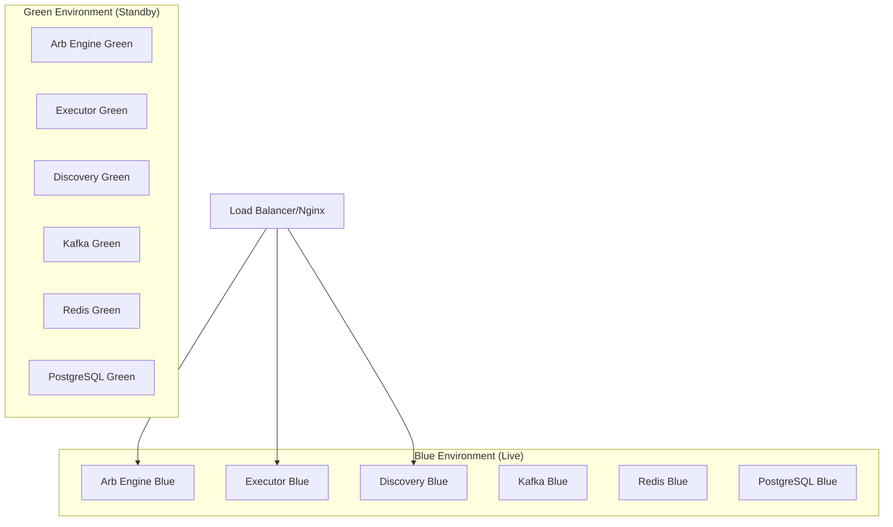

# MEVana Production Deployment Strategy

## 🏢 **NY Datacenter & Infrastructure Optimization**

### **Preferred NY Datacenters for Low-Latency Trading**

#### **Tier 1 Recommendations (Sub-1ms to major exchanges)**:
1. **Equinix NY1/NY2/NY4** (Secaucus, NJ)
   - 🎯 **Best Choice**: Direct fiber to major crypto exchanges
   - ⚡ Sub-millisecond latency to most DeFi infrastructure
   - 🔒 Enterprise security and compliance
   - 💰 Cost: $500-2000/month for bare metal

2. **Digital Realty NY (NYC)**
   - 🌐 Excellent connectivity to cloud providers
   - ⚡ Sub-2ms latency to Solana validators
   - 🔄 Hybrid cloud options
   - 💰 Cost: $400-1500/month

3. **Coresite NY1** (Manhattan)
   - 🏙️ Manhattan location advantage
   - 🔗 Direct connections to financial networks
   - ⚡ Ultra-low latency to NYSE/NASDAQ (if relevant)
   - 💰 Cost: $600-2500/month

#### **Cost-Effective Options**:
- **Vultr NYC**: $40-200/month (good starter option)
- **Linode Newark**: $60-300/month (solid performance)
- **AWS us-east-1**: Variable pricing, excellent ecosystem

### **Hardware Specs for MEV Trading**:
```yaml
Minimum Production Specs:
  CPU: 16+ cores (Intel i7-12700K or AMD Ryzen 7)
  RAM: 32GB DDR4-3200
  Storage: 1TB NVMe SSD
  Network: 1Gbps dedicated
  
Optimal Performance Specs:
  CPU: 32+ cores (Intel i9-13900K or AMD Ryzen 9)
  RAM: 64GB DDR4-3600
  Storage: 2TB NVMe SSD (Samsung 980 PRO)
  Network: 10Gbps dedicated
```

---

## 🚀 **Zero-Downtime Deployment Architecture**

### **Blue-Green Deployment Strategy**



### **In-Place Upgrade Process**:

1. **Rolling Updates** (for service updates):
```bash
# Update discovery service first (least critical)
systemctl stop mevana-discovery
# Deploy new version
systemctl start mevana-discovery

# Update arb-engine with graceful shutdown
curl -X POST http://localhost:8081/admin/graceful-shutdown
# Wait for active trades to complete
systemctl restart mevana-arb-engine

# Update executor-service last (most critical)
curl -X POST http://localhost:8080/admin/drain-connections
# Deploy new version
systemctl restart mevana-executor
```

2. **Database Migrations** (zero-downtime):
```bash
# Run migrations on standby database
./migrations/migrate-standby.sh

# Switch traffic to standby
# Migrate primary database
# Switch back

# Total downtime: < 30 seconds
```

---

## 🎯 **Scalability & Fault Tolerance Enhancements**

### **Immediate Scalability Improvements Needed**:

#### **1. Horizontal Scaling Architecture**:
```rust
// Add to executor-service/src/cluster_manager.rs
pub struct ClusterManager {
    node_id: String,
    peer_nodes: Vec<PeerNode>,
    consensus_protocol: RaftConsensus,
    work_distribution: WorkloadBalancer,
}
```

#### **2. Circuit Breakers & Health Checks**:
```rust
// Already have basic circuit breakers, enhance with:
pub enum HealthStatus {
    Healthy,
    Degraded { reason: String },
    Critical { auto_failover: bool },
    Maintenance,
}
```

#### **3. Auto-Scaling Triggers**:
```yaml
Scaling Triggers:
  CPU_Usage: > 80% for 2 minutes
  Memory_Usage: > 85% for 1 minute  
  Opportunity_Backlog: > 100 items
  Response_Time: > 50ms for 30 seconds
  
Scale_Actions:
  - Spawn additional arb-engine instances
  - Increase Kafka partition count
  - Scale Redis cluster nodes
```

### **Fault Tolerance Enhancements**:

#### **1. Multi-Region Backup** (Phase 2):
```yaml
Primary: NYC Datacenter
Backup: AWS us-west-2 (for disaster recovery)
Sync: Real-time state replication
Failover: < 10 seconds
```

#### **2. Service Mesh** (Future):
```yaml
Technology: Istio or Consul Connect
Benefits:
  - Automatic service discovery
  - Circuit breaker patterns
  - Distributed tracing
  - Canary deployments
```

---

## 📈 **Future Solana Ecosystem Expansion**

### **Jupiter Aggregator Integration** (High Priority):
```rust
// Add to executor-service/src/jupiter_integration.rs
pub struct JupiterOptimizer {
    api_client: JupiterApiClient,
    route_cache: LRUCache<String, Vec<Route>>,
    slippage_optimizer: SlippageCalculator,
}

impl JupiterOptimizer {
    // Route comparison with existing venues
    pub async fn compare_routes(&self, opportunity: &ArbitrageOpportunity) -> BestRouteResult {
        // Compare Jupiter routes vs direct venue routes
        // Choose optimal path for each trade
    }
}
```

### **Pump.fun Integration** (Medium Priority):
```rust
// Add to edge-assembler/src/pumpfun_handler.rs
pub struct PumpfunHandler {
    websocket_client: PumpfunWebSocket,
    token_discovery: NewTokenScanner,
    liquidity_analyzer: LiquidityDepthAnalyzer,
}

// Focus on:
// - New token launches (high volatility opportunities)
// - Liquidity migration detection
// - Pump-and-dump pattern recognition
```

### **Additional Venues** (Future Roadmap):
- **Drift Protocol**: Perpetuals and derivatives arbitrage
- **MangoMarkets**: Cross-margin opportunities  
- **Serum**: Legacy but still active DEX
- **Phoenix**: High-frequency trading venue
- **Zeta Markets**: Options and volatility trading

---

## 🛠️ **Deployment Timeline & Milestones**

### **Phase 1: Production Infrastructure** (Today - Tomorrow)
- [ ] **Server Selection**: Choose NY datacenter and provision
- [ ] **Base Deployment**: Deploy current MEVana stack
- [ ] **Monitoring Setup**: Grafana dashboards and alerting
- [ ] **Test Mode Validation**: 4+ hours comprehensive testing
- [ ] **Go Live**: First profitable trades

### **Phase 2: Scalability Enhancements** (Week 1-2)
- [ ] **Load Balancing**: Nginx/HAProxy setup
- [ ] **Database Replication**: Master-slave PostgreSQL
- [ ] **Redis Clustering**: High-availability caching
- [ ] **Blue-Green Deployment**: Zero-downtime updates
- [ ] **Performance Optimization**: Based on live data

### **Phase 3: Ecosystem Expansion** (Week 2-4)
- [ ] **Jupiter Integration**: Route optimization
- [ ] **Additional Venues**: Expand beyond current 4 venues
- [ ] **Advanced Strategies**: Cross-venue arbitrage
- [ ] **Risk Management**: Enhanced position sizing
- [ ] **Pump.fun Integration**: New token opportunities

---

## 💰 **Cost Optimization & ROI Planning**

### **Initial Infrastructure Costs**:
```yaml
Bare Metal Server (NY): $800-2000/month
Network/Bandwidth: $200-500/month
Monitoring Tools: $50-200/month
SSL/Security: $50-100/month

Total Monthly: $1100-2800
Daily Break-even: $37-93 profit needed
```

### **Scaling Cost Model**:
```yaml
Break-even Analysis:
  $100/day profit = $3000/month = Cover basic infrastructure
  $500/day profit = $15000/month = Scale to multi-server
  $1000/day profit = $30000/month = Full enterprise deployment
```

---

## 🎯 **Immediate Action Items**

### **Today's Server Research Focus**:

1. **Compare Latency Tests**:
```bash
# Test from potential servers to Solana validators
ping mainnet-beta.solana.com
traceroute mainnet-beta.solana.com

# Test to major RPC providers
ping api.mainnet-beta.solana.com
ping rpc.shyft.to
```

2. **Datacenter Evaluation Criteria**:
   - ✅ Latency to Solana mainnet (< 10ms target)
   - ✅ Network redundancy (multiple ISPs)
   - ✅ Power redundancy (2N+1 minimum)
   - ✅ 24/7 NOC support
   - ✅ Compliance certifications
   - ✅ Scalability options (room to grow)

3. **Deployment Strategy**:
   - Start with single high-spec server
   - Plan horizontal scaling architecture
   - Implement monitoring from Day 1
   - Design for zero-downtime updates

### **Tomorrow's Go-Live Plan**:
- [ ] Server provisioned and basic stack deployed
- [ ] Test mode validation (4+ hours)
- [ ] Wallet funded with initial capital
- [ ] Monitoring dashboards active
- [ ] First live trades executed
- [ ] Performance metrics collected for optimization

The architecture is designed to **start profitably ASAP** while **scaling to capture maximum opportunities** across the expanding Solana ecosystem! 🚀