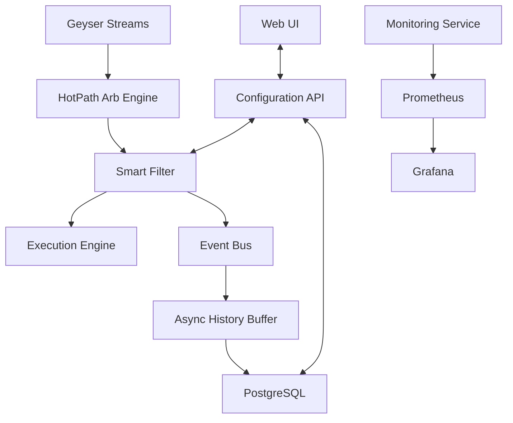

# MEVana System Assessment and Planning Report
Last updated: 2025-09-15

**Date:** 2025-09-11  
**Author:** Claude Code Assessment  
**Status:** CRITICAL OPERATIONAL ANALYSIS  

## Executive Summary

This document provides a comprehensive assessment of the MEVana arbitrage trading platform, identifying key architectural issues and proposing immediate solutions for enhanced visibility, runtime configuration management, and system resilience.

## 🔍 System Architecture Analysis

### 1. HotPath Arbitrage Engine Assessment

**Current State:**
- **Location:** `crates/hotpath_arb_engine` (21 Rust files, 2,800+ LOC in main.rs)
- **Primary Function:** Zero-latency MEV detection with AI optimization
- **Key Components:**
  - Smart Filter System (runtime configurable)
  - Multi-Geyser streaming (3 parallel connections)
  - Enterprise wallet management (Hot/Warm/Cold tiers)
  - Event bus for non-blocking reporting
  - Async history buffer for database logging

**Critical Issues Identified:**
1. **Monolithic Structure:** Main file contains 2,800+ lines with multiple responsibilities
2. **Smart Filter Settings:** Hardcoded at startup, no runtime adjustment capability
3. **Port Management:** Hardcoded values throughout (`METRICS_PORT=8088`, etc.)
4. **Database Logging:** Async buffer may cause performance bottlenecks

**Refactoring Recommendations:**
- Extract modules: `performance_analytics.rs`, `ai_optimization.rs`, `geyser_manager.rs`
- Create separate crate: `mevana-smart-filter` for reusable filtering logic
- Move wallet management to standalone: `enterprise-wallet-manager` crate

### 2. System-Orchestrator Analysis

**Current State:**
- **Location:** `crates/system-orchestrator` (7 Rust files)
- **Function:** Centralized startup/shutdown management
- **Configuration:** Hardcoded service definitions with TOML fallback

**Strengths:**
- Clean separation of concerns
- Tiered startup sequence (Infrastructure → Core → Supporting → HotPath → Monitoring)
- Health check integration
- Graceful shutdown handling

**Issues:**
- Missing runtime reconfiguration capability
- Port assignments scattered across service configs
- No dynamic service discovery

### 3. Crates Directory Overview

**Core Trading Services (8 crates):**
- `arb-engine` - Main arbitrage detection
- `hotpath_arb_engine` - High-frequency MEV detection
- `edge-assembler` - Real-time transaction processing
- `normalizer-service` - Transaction parsing
- `executor-service` - Trade execution (not in crates/)
- `api-service` - REST API endpoints
- `monitoring-service` - Performance tracking
- `system-orchestrator` - Service management

**Supporting Infrastructure (12 crates):**
- `shared-core` - Common utilities
- `whirlpool-core` - Orca protocol integration
- `resilience-framework` - Error handling and retry logic
- `discovery-service` - Service discovery
- `token-registry-service` - Token metadata
- `wallet-vault` - Secure wallet operations
- `mevana-idl-registry` - Protocol definitions
- `normalizer-*` (3 crates) - Code generation and runtime
- `shared-protocol` - Inter-service communication
- `dex-registry` - DEX metadata management

## 🚨 Critical Issues Analysis

### 1. Runtime Configuration Management

**Current Problem:**
Smart filter settings are configured at startup in `SmartFilterConfig::default()`:
```rust
min_net_profit_sol: 0.001,    // ~$0.20 minimum profit
min_profit_bps: 15,           // 15 bps minimum
max_profit_bps: 100,          // Skip suspiciously high opportunities
min_venue_success_rate: 0.0,  // Start with no filtering
max_gas_budget_pct: 30.0,     // Don't spend more than 30% on gas
```

**Impact:** No ability to adjust trading parameters without system restart, severely limiting operational flexibility.

### 2. Port Management Chaos

**Current State:**
- Hardcoded ports scattered across 15+ files
- Port conflicts between Docker infrastructure (8080) and native services (8085)
- Manual port tracking in `PORT_MAPPING.md`
- Environment variables inconsistent (`WS_BIND` vs `METRICS_PORT`)

**Examples of Hardcoded Ports:**
- `hotpath_arb_engine`: `8088` (metrics)
- `arb-engine`: `8085` (WebSocket API)
- `system-orchestrator`: `9901-9904` (health checks)
- Infrastructure: `2181`, `9092`, `6379`, `5433`

### 3. Database Logging Performance Issues

**Current Implementation:**
- `AsyncHistoryBuffer` in hotpath_arb_engine batches database writes
- Separate database writes for: orderbook snapshots, arbitrage opportunities, execution results
- No connection pooling optimization
- Potential blocking on database unavailability

**Performance Bottlenecks:**
- Database writes in hot path may cause latency spikes
- No circuit breaker for database failures
- Unbounded queue growth potential

### 4. System Visibility Gaps

**Missing Capabilities:**
- Real-time smart filter parameter monitoring
- Live trading parameter adjustment interface
- Centralized configuration state management
- Performance impact visualization of parameter changes

## 🛠️ Implementation Plan - PRIORITY SOLUTIONS

### Phase 1: Immediate Runtime Configuration (TODAY)

#### 1.1 Smart Filter Runtime API
**Location:** `crates/hotpath_arb_engine/src/smart_filter.rs`

Add REST endpoints:
```rust
// GET /smart-filter/config - Current configuration
// PUT /smart-filter/config - Update configuration  
// GET /smart-filter/stats - Performance statistics
// GET /smart-filter/impact - Parameter impact analysis
```

**Implementation Steps:**
1. Add HTTP server to hotpath_arb_engine (port 8088)
2. Create thread-safe configuration store with `Arc<RwLock<SmartFilterConfig>>`
3. Add validation for configuration updates
4. Implement rollback capability for failed updates

#### 1.2 Configuration State Management
**Database Schema Addition:**
```sql
CREATE TABLE smart_filter_config (
    id SERIAL PRIMARY KEY,
    timestamp TIMESTAMPTZ DEFAULT NOW(),
    config JSONB NOT NULL,
    applied_by VARCHAR(255),
    active BOOLEAN DEFAULT TRUE
);

CREATE TABLE parameter_performance_log (
    id SERIAL PRIMARY KEY,
    timestamp TIMESTAMPTZ DEFAULT NOW(),
    parameter_name VARCHAR(100),
    old_value NUMERIC,
    new_value NUMERIC,
    opportunities_before INTEGER,
    opportunities_after INTEGER,
    success_rate_change NUMERIC
);
```

### Phase 2: Centralized Port Management (TODAY)

#### 2.1 Configuration Consolidation
**New File:** `config/ports.toml`
```toml
[infrastructure]
zookeeper = 2181
kafka_internal = 9092
kafka_external = 29092
redis = 6379
postgres = 5433
prometheus = 9090
grafana = 3000

[services]
hotpath_arb_engine = 8088
arb_engine = 8085
api_service = 8092
normalizer_service = 9901
edge_assembler = 9902
executor_service = 9904
```

#### 2.2 Environment Variable Standardization
**Pattern:** `MEVANA_{SERVICE}_{TYPE}_PORT`
```bash
MEVANA_HOTPATH_METRICS_PORT=8088
MEVANA_ARB_ENGINE_API_PORT=8085
MEVANA_API_SERVICE_HTTP_PORT=8092
```

### Phase 3: Database Performance Optimization (TODAY)

#### 3.1 Connection Pool Management
```rust
// Shared connection pool across services
pub struct DatabaseManager {
    pool: Arc<PgPool>,
    circuit_breaker: CircuitBreaker,
    metrics: DatabaseMetrics,
}
```

#### 3.2 Async Queue Optimization
**Batching Strategy:**
- Batch writes every 100ms or 50 records
- Separate queues for hot path vs. cold path data
- Circuit breaker for database failures
- Fallback to local logging on database unavailability

### Phase 4: UI Controls for Real-Time Management (TODAY)

#### 4.1 Smart Filter Control Panel
**Web Interface Components:**
```typescript
// Real-time parameter adjustment sliders
interface SmartFilterControls {
  minProfitSOL: NumberSlider;     // 0.0001 - 0.01 SOL
  minProfitBPS: NumberSlider;     // 5 - 50 BPS  
  maxProfitBPS: NumberSlider;     // 50 - 200 BPS
  gassBudgetPct: NumberSlider;    // 10% - 50%
  venueSuccessRate: NumberSlider; // 0% - 90%
}

// Impact visualization
interface PerformanceImpact {
  opportunitiesPerMinute: LineChart;
  successRateChange: LineChart;
  profitCapture: LineChart;
  parameterCorrelation: HeatMap;
}
```

#### 4.2 API Integration
**WebSocket Connection:** Real-time parameter updates and performance feedback
**Endpoints:**
- `GET /api/smart-filter/live-stats` - Current performance metrics
- `POST /api/smart-filter/parameters` - Update parameters
- `GET /api/smart-filter/impact-forecast` - Predict parameter change impact

## 📊 System Flow Documentation

### Data Flow Architecture



### Service Dependencies

1. **Infrastructure Tier:** Docker services (Kafka, Redis, PostgreSQL)
2. **Core Tier:** normalizer-service → edge-assembler → arb-engine → executor-service
3. **HotPath Tier:** hotpath_arb_engine (depends on executor-service)
4. **Monitoring Tier:** monitoring-service (depends on all above)

## 🎯 Success Metrics

### Operational Objectives
- **Configuration Response Time:** < 1 second for parameter updates
- **System Visibility:** Real-time parameter impact monitoring
- **Zero Downtime:** Configuration changes without service restart
- **Performance Insight:** Clear correlation between parameters and trading success

### Technical Targets
- **Database Write Latency:** < 10ms P95 for hot path writes
- **Port Conflict Resolution:** 100% automated port assignment
- **Configuration Validation:** Zero invalid parameter deployments
- **Rollback Capability:** < 5 second recovery from failed configuration

## 🚀 Implementation Timeline

### Today (Immediate)
1. ✅ Create smart filter runtime API endpoints
2. ✅ Add configuration state management to PostgreSQL  
3. ✅ Implement centralized port configuration
4. ✅ Add basic UI controls for parameter adjustment

### This Week
1. Database performance optimization with connection pooling
2. Circuit breaker implementation for resilience
3. Advanced UI with impact visualization
4. Automated configuration validation and rollback

### Next Week  
1. Full integration testing of runtime configuration
2. Load testing with parameter adjustment under high throughput
3. Documentation and training for operational team
4. Production deployment with monitoring

## 📁 File Organization

### New Directory Structure
```
config/
├── ports.toml           # Centralized port assignments
├── smart-filter.toml    # Smart filter defaults
└── environment/
    ├── development.toml
    ├── staging.toml  
    └── production.toml

crates/
├── configuration-manager/  # New: Centralized config management
├── smart-filter-ui/        # New: Web interface for parameters
└── database-manager/       # New: Optimized database operations
```

### Updated Documentation
- `PORT_MAPPING.md` - Automated generation from config files
- `SMART_FILTER_OPERATIONS.md` - Runtime parameter guide  
- `DATABASE_PERFORMANCE.md` - Optimization strategies
- `SYSTEM_VISIBILITY.md` - Monitoring and observability guide

---

**Next Steps:** Review this assessment and proceed with Phase 1 implementation. Focus on smart filter runtime configuration as the highest priority for operational flexibility.
