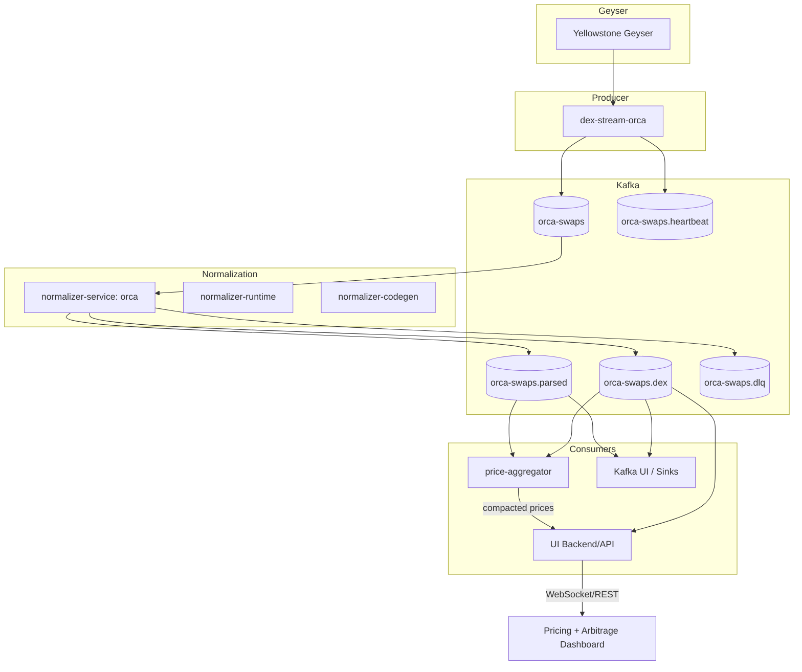
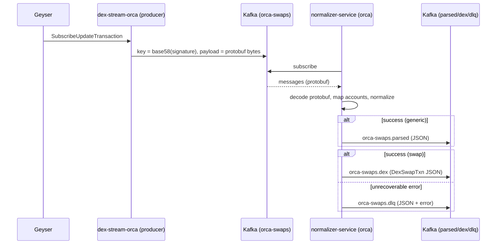

# Normalizer Stack — Docs & Diagrams (Orca v1)
Last updated: 2025-09-15

> This document captures the architecture, topics/contracts, runbooks, and near‑term plan to ship the **Orca normalizer** and a small **pricing + arbitrage UI**.

---

## TL;DR

- **dex-stream-orca** streams raw Yellowstone Geyser transaction updates → **Kafka: **`` (key = tx signature, payload = protobuf bytes).
- **normalizer-service (Orca)** consumes `orca-swaps`, decodes, and publishes:
  - ``: generic normalized instruction JSON
  - ``: Orca swap–specific JSON (`DexSwapTxn`)
  - ``: dead-letter for unrecoverable errors
- **normalizer-runtime**: shared Kafka/plumbing/metrics utilities.
- **normalizer-codegen**: optional: generate decoders & account mappers from IDLs.
- **Near-term UI**: lightweight dashboard for **current pricing** (compacted topic) + **arbitrage opportunities** (streamed), fed by a small **price-aggregator** service.

---

## High-level Architecture



---

## Sequence (produce → normalize → consume)



---

## Crates & Responsibilities

### 1) dex-stream-orca (producer)

- **In:** Yellowstone Geyser stream
- **Out:** `orca-swaps` (key = tx signature; payload = raw `SubscribeUpdateTransaction` bytes)
- **Notes:** idempotent producer; periodic **heartbeat** → `orca-swaps.heartbeat`; logs stats every 10s; connection retry with backoff.

### 2) normalizer-service (Orca)

- **In:** `orca-swaps` (protobuf)
- **Out:**
  - `orca-swaps.parsed` (generic instruction JSON)
  - `orca-swaps.dex` (swap-specific JSON)
  - `orca-swaps.dlq` (dead-letter JSON)
- **Semantics:** at-least-once; commit only after successful publish.
- **Observability:** counters, heartbeat, structured logs (per 10s tick + sample delivery logs).

### 3) normalizer-runtime (lib)

- Kafka factory (consumer/producer), retry/backoff helpers, heartbeat task, json/prost helpers, config loader (clap+env), logging bootstrap.

### 4) normalizer-codegen (tool)

- Input: Anchor IDLs (Whirlpool, Token Program)
- Output: strongly-typed instruction enums, account mappers, serde schemas.

---

## Kafka Topics — Contracts

### `orca-swaps` (input)

- **key**: `base58(signature)` or `slot:<num>` if no signature
- **value**: `SubscribeUpdateTransaction` encoded via prost bytes
- **retention**: 24–168h (configurable). Not compacted.

### `orca-swaps.parsed` (generic normalized)

- **key**: `base58(signature)`
- **value** (example):

```json
{
  "signature": "5v...Vj",
  "slot": 279890001,
  "block_time": 1755180604,
  "program_id": "whirLbMiicV...",
  "ix_name": "swapV2",
  "accounts": [
    {"name":"tokenProgram","pubkey":"TokenkegQfe...","is_signer":false,"is_writable":false}
  ],
  "data": {"...": "instruction-specific object"},
  "parent_program": null
}
```

### `orca-swaps.dex` (swap detection)

- **key**: `base58(signature)`
- **value** (`DexSwapTxn`):

```json
{
  "tx_signature": "5v...Vj",
  "slot": 279890001,
  "block_time": 1755180604,
  "dex": "Orca",
  "pool_address": "...",
  "user_wallet": "...",
  "token_in": "mintA",
  "token_out": "mintB",
  "amount_in": 1.2345,
  "amount_out": 2.3456,
  "platform_fee_bps": 6,
  "route": null
}
```

### `orca-swaps.dlq` (dead-letter)

- **key**: `base58(signature)` if available
- **value**:

```json
{
  "error": "prost decode failed: ...",
  "stage": "decode|normalize|publish",
  "slot": 279890001,
  "raw": "base64-of-original-payload-or-truncated",
  "ts": 1755180604
}
```

### Heartbeat

- `orca-swaps.heartbeat` (producer liveness). Consider a **normalizer heartbeat** too: `orca-swaps.parsed.heartbeat`.

---

## Runbook (build & run)

### Producer (already running)

```
ENDPOINT=https://grpc.ny.shyft.to \
X_TOKEN=... \
KAFKA_BROKER=localhost:29092 \
TOPIC=orca-swaps \
cargo run -p dex-stream-orca
```

### Normalizer (Orca generic → parsed)

```
KAFKA_BROKER=localhost:29092 \
INPUT_TOPIC=orca-swaps \
OUTPUT_TOPIC=orca-swaps.parsed \
DLQ_TOPIC=orca-swaps.dlq \
GROUP_ID=normalizer-orca-v1 \
cargo run -p normalizer-orca
```

**Smoke check:**

- Kafka UI: watch `orca-swaps.parsed` grow
- CLI consumer:

```
docker exec -it kafka bash -lc \
  'kafka-console-consumer --bootstrap-server localhost:9092 \
    --topic orca-swaps.parsed --from-beginning --max-messages 5'
```

---

## Code Skeletons

### `normalizer-orca` main loop (generic only)

```rust
use anyhow::{Context, Result};
use rdkafka::{consumer::{Consumer, StreamConsumer}, producer::{FutureProducer, FutureRecord}, ClientConfig, Message};
use std::time::Duration;
use yellowstone_grpc_proto::prelude::SubscribeUpdateTransaction;
use yellowstone_grpc_proto::prost::Message as _;

#[tokio::main]
async fn main() -> Result<()> {
    dotenv::dotenv().ok();
    env_logger::init();

    let broker   = std::env::var("KAFKA_BROKER").unwrap_or("localhost:29092".into());
    let in_topic = std::env::var("INPUT_TOPIC").unwrap_or("orca-swaps".into());
    let out_topic= std::env::var("OUTPUT_TOPIC").unwrap_or("orca-swaps.parsed".into());
    let dlq_topic= std::env::var("DLQ_TOPIC").unwrap_or("orca-swaps.dlq".into());
    let group_id = std::env::var("GROUP_ID").unwrap_or("normalizer-orca-v1".into());

    let consumer: StreamConsumer = ClientConfig::new()
        .set("bootstrap.servers", &broker)
        .set("group.id", &group_id)
        .set("enable.auto.commit", "false")
        .set("auto.offset.reset", "latest")
        .create()?;
    consumer.subscribe(&[&in_topic])?;

    let producer: FutureProducer = ClientConfig::new()
        .set("bootstrap.servers", &broker)
        .set("enable.idempotence", "true")
        .set("compression.type", "lz4")
        .create()?;

    log::info!("normalizer-orca: broker={} in={} out={} dlq={}", broker, in_topic, out_topic, dlq_topic);

    loop {
        let msg = consumer.recv().await?;
        let key = msg.key().map(|k| k.to_vec()).unwrap_or_else(|| b"no-key".to_vec());

        let res: Result<()> = (|| {
            let bytes = msg.payload().context("empty payload")?;
            let update = SubscribeUpdateTransaction::decode(bytes).context("prost decode")?;
            let norm = normalize_generic(&update).context("normalize")?;
            let json = serde_json::to_vec(&norm).context("serialize json")?;
            futures::executor::block_on(
                producer.send(FutureRecord::to(&out_topic).key(&key).payload(&json), Duration::from_secs(5))
            ).map_err(|(e, _)| e).context("produce")?;
            Ok(())
        })();

        match res {
            Ok(()) => consumer.commit_message(&msg, rdkafka::consumer::CommitMode::Async)?,
            Err(err) => {
                log::error!("normalize error: {:?}", err);
                let dlq = serde_json::json!({
                    "error": format!("{:?}", err),
                    "stage": "decode|normalize|publish",
                    "ts": chrono::Utc::now().timestamp(),
                });
                let _ = producer.send(
                    FutureRecord::to(&dlq_topic).key(&key).payload(&dlq.to_string()),
                    Duration::from_secs(5)
                ).await;
                consumer.commit_message(&msg, rdkafka::consumer::CommitMode::Async)?;
            }
        }
    }
}

fn normalize_generic(update: &SubscribeUpdateTransaction) -> Result<serde_json::Value> {
    // TODO: fill using account mappers + IDLs
    Ok(serde_json::json!({
        "signature": update.transaction.as_ref().map(|t| bs58::encode(&t.signature).into_string()),
        "slot": update.slot
    }))
}
```

### `price-aggregator` (sketch)

- Consumes `orca-swaps.parsed` & `orca-swaps.dex`
- Maintains in-memory latest mid/price per pool/mint pair
- Publishes **compacted** topic `prices.latest` keyed by `pool` or `mintA-mintB`
- Emits arbitrage candidates to `arbs.found`

```mermaid
graph LR
  T2[(orca-swaps.parsed)] --> P[price-aggregator]
  T3[(orca-swaps.dex)] --> P
  P --> PL[(prices.latest):::compacted]
  P --> AR[(arbs.found)]

  classDef compacted fill:#eaffea,stroke:#2e7d32,stroke-width:1px;
```

**Compaction tip:**

```
# create compacted topic (once)
kafka-topics --bootstrap-server localhost:9092 \
  --create --if-not-exists --topic prices.latest \
  --partitions 3 --replication-factor 1 \
  --config cleanup.policy=compact
```

---

## Env Vars (summary)

**Producer (dex-stream-orca)**

- `KAFKA_BROKER` (e.g., `localhost:29092`)
- `TOPIC` (e.g., `orca-swaps`)
- `ENDPOINT`, `X_TOKEN`

**Normalizer (orca)**

- `KAFKA_BROKER`
- `INPUT_TOPIC` (default: `orca-swaps`)
- `OUTPUT_TOPIC` (default: `orca-swaps.parsed`)
- `DLQ_TOPIC` (default: `orca-swaps.dlq`)
- `GROUP_ID` (default: `normalizer-orca-v1`)

**Price Aggregator**

- `KAFKA_BROKER`
- `INPUT_TOPICS` (comma: `orca-swaps.parsed,orca-swaps.dex`)
- `PRICES_TOPIC` (default: `prices.latest`, compacted)
- `ARBS_TOPIC` (default: `arbs.found`)

---

## Incremental Plan to UI (today)

**Milestone A – Normalizer generic** ✅

-

**Milestone B – Swap detector (Orca)**

-

**Milestone C – Pricing + Arbitrage**

-

**Milestone D – UI**

-

---

## Testing & Verification

- **Connectivity:** `nc -vz localhost 29092`, Kafka UI reachable
- **Topic existence:** `kafka-topics --describe --topic orca-swaps`
- **Throughput sanity:** watch producer/normalizer logs every 10s
- **Contract check:** consume 5 messages from each topic and validate example JSON shape

---

## Future Work (post-v1)

- Prometheus metrics + Grafana dashboards
- Schema Registry + versioned payloads
- Exactly-once pipelines (transactions + idempotent sinks)
- Multi‑DEX support (extend normalizer-service via feature flags or per‑DEX binaries)
- Historical backfill (separate job) and reconciliation

---

*End of document.*

