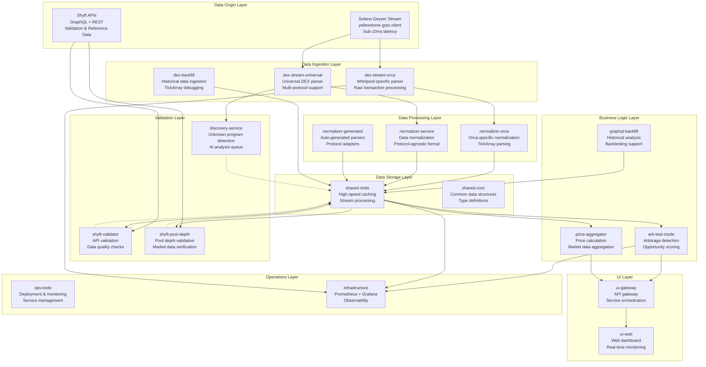

# MEVana Data Flow Architecture
Last updated: 2025-09-15
**Date:** 2024-12-17  
**Version:** 1.0  
**Status:** Current System Architecture

## Overview
This document outlines the complete data flow architecture for the MEVana system, tracing data from its origin (Solana Geyser stream) through processing, validation, and arbitrage detection. The system is designed for sub-10ms latency arbitrage detection with real-time validation against Shyft APIs.

## System Architecture

## Data Flow Sequence

### 1. **Data Ingestion (Sub-10ms Latency)**
- **Source**: Solana Geyser stream via `yellowstone-grpc-client`
- **Services**: `dex-stream-orca`, `dex-stream-universal`
- **Output**: Raw transaction data to Kafka topics

### 2. **Data Processing & Normalization**
- **Input**: Raw transaction data from Kafka
- **Services**: `normalizer-service`, `normalizer-orca`, `normalizer-generated`
- **Output**: Normalized swap events in protocol-agnostic format

### 3. **Data Storage & Caching**
- **Service**: `shared-redis`
- **Purpose**: High-speed caching for arbitrage detection
- **Format**: Stream-based storage for real-time processing

### 4. **Validation & Quality Assurance**
- **Services**: `shyft-validator`, `shyft-pool-depth`
- **Purpose**: Validate our parsing against Shyft APIs
- **Output**: Data quality metrics and validation results

### 5. **Arbitrage Detection**
- **Service**: `arb-test-mode`
- **Input**: Normalized swap events from Redis
- **Output**: Identified arbitrage opportunities

### 6. **Market Data & Price Calculation**
- **Service**: `price-aggregator`
- **Purpose**: Calculate accurate prices and market data
- **Input**: Pool depth data, swap events

### 7. **Discovery & AI Analysis**
- **Service**: `discovery-service`
- **Purpose**: Detect unknown programs for AI analysis
- **Output**: Queued programs for AI investigation

## Service Responsibilities

### Core Data Pipeline
- **`dex-stream-orca`**: Whirlpool-specific transaction parsing
- **`dex-stream-universal`**: Multi-protocol transaction parsing
- **`normalizer-service`**: Protocol-agnostic data normalization
- **`shared-redis`**: High-speed data caching and streaming

### Validation & Quality
- **`shyft-validator`**: API-based data validation
- **`shyFT-pool-depth`**: Pool depth validation
- **`discovery-service`**: Unknown program detection

### Business Logic
- **`arb-test-mode`**: Arbitrage opportunity detection
- **`price-aggregator`**: Price calculation and market data
- **`graphql-backfill`**: Historical data analysis

### Infrastructure
- **`ui-gateway`**: API gateway and service orchestration
- **`ops-tools`**: Deployment and monitoring
- **`infrastructure`**: Prometheus + Grafana observability

## Data Quality Assurance

### Real-time Validation
1. **Geyser Stream**: Primary data source (sub-10ms latency)
2. **Shyft APIs**: Validation and reference data
3. **Cross-validation**: Compare our parsing with Shyft results
4. **Market data**: Verify against live market prices

### Data Quality Metrics
- **Latency**: Sub-10ms from Geyser to processing
- **Accuracy**: Validated against Shyft APIs
- **Completeness**: Full transaction parsing coverage
- **Freshness**: Real-time market data updates

## Testing Strategy

### End-to-End Testing
1. **Data Pipeline Flow**: Test complete data flow from Geyser to arbitrage detection
2. **Validation Pipeline**: Test Shyft API validation accuracy
3. **Performance Testing**: Verify sub-10ms latency requirements
4. **Data Quality Testing**: Ensure accuracy and completeness

### Component Testing
1. **Parser Testing**: Test each normalizer and parser
2. **Redis Operations**: Test caching and streaming
3. **API Integration**: Test Shyft API connections
4. **Arbitrage Logic**: Test opportunity detection algorithms

## Performance Requirements

- **Latency**: Sub-10ms from Geyser to processing
- **Throughput**: Handle high-volume transaction streams
- **Reliability**: 99.9% uptime for arbitrage detection
- **Accuracy**: 99.5% data parsing accuracy

## Monitoring & Observability

- **Prometheus**: Metrics collection and alerting
- **Grafana**: Real-time dashboards and visualization
- **Custom Metrics**: Arbitrage opportunities, latency, accuracy
- **Alerting**: Data quality degradation, latency spikes

## Next Steps

1. **Implement comprehensive testing suite** for data pipeline validation
2. **Add real-time market data validation** against CoinGecko/CoinMarketCap
3. **Implement automated data quality monitoring** with alerting
4. **Add performance benchmarking** for latency and throughput
5. **Create data lineage tracking** for audit and debugging

---

**Note**: This architecture prioritizes speed (sub-10ms latency) while maintaining data quality through real-time validation against Shyft APIs. The hybrid approach ensures we get the best of both worlds: speed from Geyser streams and accuracy from API validation.
