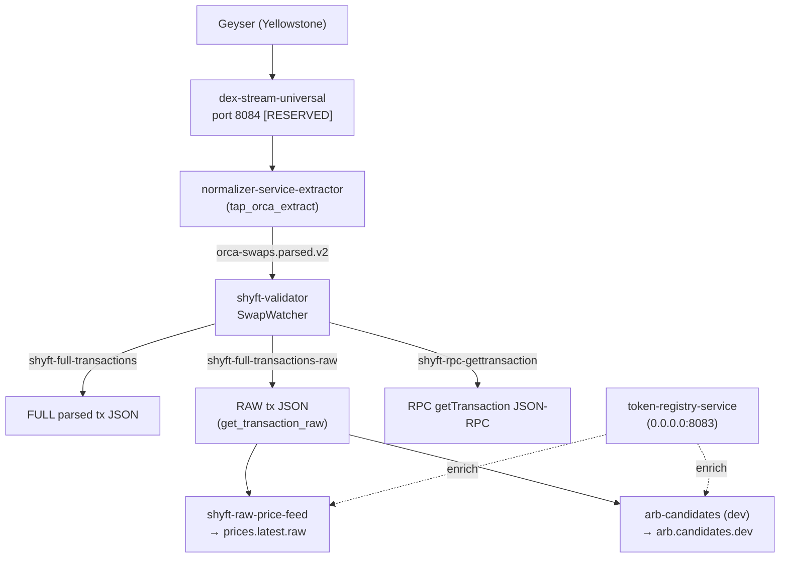

### AI-Friendly: Live Arbitrage Data Pipeline (as of 2025-08-20 05:30 UTC)

This document captures the current end-to-end flow for building a low-latency arbitrage dataset, the services involved, Kafka topics, ports, and how they fit together. Use this as the source of truth to avoid rediscovering the same details.

#### High-level flow

#### Services and roles

- dex-stream-universal (port 8084, reserved)
  - Ingests Geyser and streams transactions into Kafka.
  - Health/metrics via `BIND_ADDRESS`, `HEALTH_PORT`.

- normalizer-service-extractor (a Docker service; binary is `tap_orca_extract` in `normalizer-service`)
  - Parses DEX-specific transactions (Orca/Raydium/Meteora extractors, registry-driven).
  - Publishes normalized swaps to Kafka topic: `orca-swaps.parsed.v2`.
  - Health/metrics configurable (see `crates/normalizer-service/src/bin/tap_orca_extract.rs`).

- shyft-validator
  - Consumes `orca-swaps.parsed.v2` and, for each swap signature, calls Shyft APIs:
    - `get_full_transaction_json` → publishes to `shyft-full-transactions`.
    - `get_transaction_raw` → publishes to `shyft-full-transactions-raw`.
    - `get_transaction_via_rpc` (Shyft RPC getTransaction) → publishes to `shyft-rpc-gettransaction`.
  - Sliding-window delay logic adapts to API readiness.

- token-registry-service (HTTP)
  - Env: `RPC_URL`, `BIND_ADDRESS` (default `0.0.0.0:8083`), `REDIS_URL`, `CACHE_TTL_SECS`.
  - Endpoint: `/v1/token/:mint` returns decimals/stability; read-through Redis cache.

- shyft-raw-price-feed
  - Consumes `shyft-full-transactions-raw` (default).
  - Enriches with `token-registry-service` (optional env `TOKEN_REGISTRY_URL`).
  - Publishes price ticks to `prices.latest.raw`.

- arb-candidates (dev) [new minimal bin]
  - Consumes `shyft-full-transactions-raw`, extracts essentials (signature, blockTime), and publishes `arb.candidates.dev`.
  - Intended for rapid dev; will grow with latency metrics and additional fields.

#### Kafka topics (active)

- Input/derived
  - `dex-transactions` (binary/protobuf from Geyser; source for normalizer)
  - `orca-swaps.parsed.v2` (normalized swaps)

- Shyft API outputs (from shyft-validator SwapWatcher)
  - `shyft-full-transactions` (full parsed JSON)
  - `shyft-full-transactions-raw` (RAW JSON; primary for dev-phase joining)
  - `shyft-rpc-gettransaction` (JSON-RPC result)

- Downstream outputs
  - `prices.latest.raw` (from shyft-raw-price-feed)
  - `arb.candidates.dev` (from arb-candidates dev bin)

#### Ports and bindings (see also docs/NETWORK_PORT_REGISTRY.md)

- 8084: dex-stream-universal [RESERVED]
- 8085: normalizer-service (health/metrics)
- 8086: shyft-validator (health/metrics)
- 8083: token-registry-service (HTTP)
- 8081: ui-gateway (HTTP/WS)

All network settings must be configurable via env or config files (no hardcoded addresses).

#### Environment variables (common)

- `KAFKA_BROKER` (e.g., `localhost:29092`)
- `BIND_ADDRESS`, `HEALTH_PORT` for HTTP services
- token-registry-service: `RPC_URL`, `REDIS_URL`, `CACHE_TTL_SECS`
- shyft-validator: `SHYFT_API_KEY`, `SHYFT_NETWORK`
- shyft-raw-price-feed: `INPUT_TOPIC`, `OUTPUT_TOPIC`, `TOKEN_REGISTRY_URL`

#### Validated sample (2025-08-20)

- `shyft-full-transactions-raw`: contains Whirlpool SWAP (EURC→USDC) with `blockTime`, `slot`, `parsed.actions`, `liquidity_pool_address`, and `transaction_signature`. Matches price-feed expectations.
- `dex-transactions`: confirmed live (metadata observed via Kafka console).

#### How we proceed (staged)

1) Keep price and candidate streams flowing
   - Ensure shyft-validator SwapWatcher is running; it produces `shyft-full-transactions-raw`.
   - Run shyft-raw-price-feed with `INPUT_TOPIC=shyft-full-transactions-raw` → `prices.latest.raw`.
   - Keep arb-candidates dev bin running → `arb.candidates.dev` (add latency fields next).

2) Add latency metrics (Prometheus)
   - In arb-candidates and price-feed: measure ingest→emit and include `blockTime` when available.
   - Expose simple `/metrics` counters/histograms per service.

3) Caching and enrichment
   - Continue token-registry-service for decimals/stable flags (LRU + Redis TTL).
   - Plan for pool metadata cache (fee tier, tick spacing) via `normalizer-service-extractor` and/or `graphql-backfill` into Redis/compacted topic.

4) Production Geyser-only path
   - When ready, parse directly from `dex-transactions` to produce the same shapes as `shyft-full-transactions-raw`. Run both in parallel for validation, then disable RPC/API paths.

5) Documentation & guardrails
   - Maintain `docs/NETWORK_PORT_REGISTRY.md` (8084 reserved for dex-stream-universal).
   - Keep this doc updated as topics or bindings change; include timestamps.

#### References

- `crates/shyft-validator/src/swap_watcher.rs`: publishes to `shyft-full-transactions(-raw)` and `shyft-rpc-gettransaction`.
- `crates/normalizer-service/src/bin/tap_orca_extract.rs`: extractor pipeline.
- `crates/token-registry-service/src/main.rs`: live RPC + Redis cache.
- `crates/shyft-raw-price-feed/src/main.rs`: consumes `shyft-full-transactions-raw` → `prices.latest.raw`.
- `docs/NETWORK_PORT_REGISTRY.md`: reserved ports and policy.

Deprecated: Incorporated into docs/strategy/STRATEGY_AND_PLANNING_CONSOLIDATED.md
Last updated: 2025-09-15

